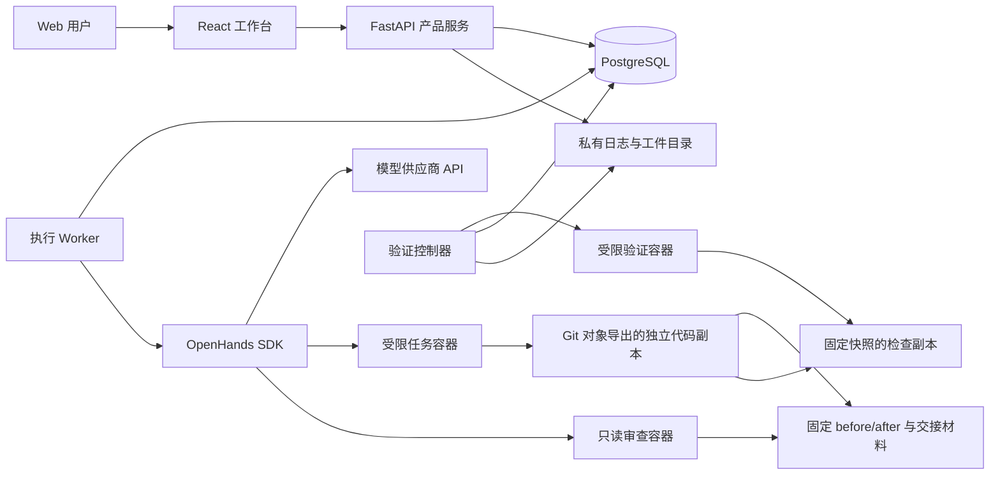

# DooNex 首版架构

更新：2026-11-06 · 状态：M1–M3、M4 发现/生成切片和 M5 自托管社区均有受控验收证据；最终整合代码通过 1199 项本机测试。M4 的 SDK 续接缺陷已修复并获真实续接证据，后续真实 60 秒及 180 秒模型请求均超时，整批和前台等待上界验收仍未完成，完整未知日预留保留，见 [M4 实施记录](M4_IMPLEMENTATION.md)。社区本机验收及未公开部署边界见 [M5 实施记录](M5_IMPLEMENTATION.md)，私有竞技见 [M3 实施记录](M3_IMPLEMENTATION.md)，多项目与单 Agent 历史分别见 [M2](M2_IMPLEMENTATION.md)、[M1](M1_IMPLEMENTATION.md)。

## 1. 选择与边界

当前采用 React + TypeScript + Vite、Python 3.12 + FastAPI、OpenHands Software Agent SDK 1.60.1、PostgreSQL 和受限 Docker 工具。M2–M5 继续复用该栈；应用服务与独立 worker 在 Mac mini 宿主机运行，数据库由 Compose 启动；不向任务传入 Docker socket，不引入 Kubernetes、Redis、向量数据库或自研模型网关。

考虑过的路径：

| 方案 | 优点 | 成本与决定 |
| --- | --- | --- |
| 复用 SDK，自建工作台与评测 | 利用现成运行能力，聚焦产品差异 | 首选；M1 验证所需生命周期与隔离能力 |
| 深度修改整个 OpenHands 应用 | 可沿用较多现成功能 | 需要跟随上游 UI 与业务结构变化；暂不采用 |
| 自研完整 Agent 引擎 | 底层行为完全自行决定 | 重复建设工具、上下文、恢复及模型接入；无验证需求前不采用 |

Python 依赖由 `uv.lock` 锁定，前端由 `apps/web/pnpm-lock.yaml` 锁定。当前任务镜像为 `python:3.12.12-slim-bookworm@sha256:593bd06efe90efa80dc4eee3948be7c0fde4134606dd40d8dd8dbcade98e669c`；PostgreSQL 镜像见 `compose.yaml`，同样使用内容摘要，不使用浮动 `latest`。本机安装和启动以 [README](../README.md) 为准。

M1 已用 `gpt-6.1-sol` 的 Responses 路径完成受控样例的真实修改与固定快照检查；M2 以同一模型配置在两个独立项目完成执行、只读审查批准与最终固定快照验证。先前 Chat `NotFound`、Responses 限流和 M2 首轮调用预算停止均保留。OpenAI 适配器支持 Chat/Responses，Anthropic 适配器仅支持 Chat 且尚未真实调用验证。配置的模型名与静态元数据不代表所有模型能力成立；具体结果与失败记录见实施记录。

## 2. 组件职责



- **Web 工作台**：显示产品状态和证据，发出用户操作；不持有供应商密钥，不直接操纵宿主机。
- **产品服务**：管理稳定项目 ID、不可变运行输入、固定角色分配、权限、共享预算与证据；同时管理不可变 Skill/任务集、手动评测批次、场景推荐和历史。
- **执行 worker**：领取有持久状态的任务，驱动 SDK；当前为一个有效 worker，进程独立于 Web/API；PostgreSQL 会话级全局 advisory lock 防止双 worker，运行 owner 阻止旧执行者在被接管后继续写状态与结算。
- **SDK**：处理 Agent、会话、工具、模型交互和工作环境接入；用一个薄集成模块连接，不预建通用插件框架。
- **任务环境**：从明确提交的 Git 对象导出独立代码副本，不执行 checkout hooks/filters，不带 `.git` 或原工作区未提交内容。受控 shell 每次启动新容器，挂载 `/workspace`，选择 Skill 时另有只读 `/skills`，默认无网络；执行者挂载可写副本，审查者只读挂载交接上下文，均不能使用依赖 `.git` 的命令。
- **验证器**：在 Agent 写入停止后生成覆盖新增/删除、文件内容和文件权限的固定快照，并为每条预先保存的验收命令创建全新检查副本，避免前一检查污染后一检查。验证控制器只负责调度和收集结果；安装脚本、测试命令和被测代码均在受限验证环境执行，不继承控制器的数据库或秘密凭据。Arena 的最终验收器来自已冻结的独立目录，仅验证期只读挂载到 `/verifier`；模型执行期不挂载，也不向模型发送隐藏检查命令。验证上下文与检查器摘要绑定报告。

SDK 接口和内部持久化结构可能变化。DooNex 保存自己的产品状态和关联 ID，不重写 SDK 的模型协议、Agent 循环或事件格式。当前适配层包含针对 1.60.1 的私有覆盖：禁用宿主技能/插件/记忆发现、默认额外工具、模型元数据探测，控制预算前置与秘密序列化边界，并实现逐工具暂停、SDK 事件/动作回执与安全续接。它们不是稳定的上游扩展合同，升级 SDK 必须重跑隐私、工具、预算、持久化、调度让出及拒绝重放测试。

SDK 导入前，独立 worker 删除继承的 `LMNR_PROJECT_API_KEY`、`OTEL_ENDPOINT`、`OTEL_EXPORTER_OTLP_TRACES_ENDPOINT`、`OTEL_EXPORTER_OTLP_ENDPOINT`，固定 `LITELLM_MODE=PRODUCTION`、`LITELLM_LOCAL_MODEL_COST_MAP=True`、`OTEL_SDK_DISABLED=true`，防止隐式 `.env` 发现、远程价格表下载与遥测外发。若进程已初始化 tracing 或 LiteLLM 回调则拒绝复用；这不修改用户 shell 的环境。细节以 `apps/server/doonex/sdk.py` 为准。

## 3. 数据与证据

| 概念 | 最少需要保存的内容 |
| --- | --- |
| Project | 项目标识、授权路径、仓库身份、允许的工具与环境配置 |
| Task | 需求、验收规则及版本、所属项目、授权范围 |
| Run | 每次尝试的 ID、任务 ID、起始版本、状态、模型配置、Skill 版本、预算和时间 |
| Agent assignment | 所属运行、角色、职责、父子关系、工作区和交接版本 |
| Event | 顺序号、运行 ID、事件类型、时间、脱敏后的内容或工件引用 |
| Evidence | 最终代码快照标识、diff、检查器版本、命令、退出码、日志与环境 |
| Skill version | 来源、许可证状态、内容哈希、依赖与权限声明、适用任务 |
| Evaluation | 任务集版本、固定配置、各次运行引用、失败分类及汇总口径 |
| Recommendation | 场景、候选版本、证据引用、选择者、生效时间和上一个推荐 |

上表是产品语义，不表示所有表和功能已实现。核心执行表为 `projects`、`runs`、`events` 与 `actions`；M1 的单例 `project` 保留为迁移来源，初始化按原 ID/路径迁移，重复启动不覆盖已有项目。不可变任务输入和验收版本保存在 Run 的 `request` 中，角色 assignment、独立会话标识、阶段与分项用量保存在 Run JSON 中；没有独立 Task 表或任意子任务调度。M3 另有 `library_versions` 保存版本清单及审核，`arena_evaluations` 保存冻结计划及批次总账，`arena_recommendations`/`arena_current` 分离推荐历史和当前选用。M4 另有后台授权、日账和分配表，详见本页的首片实现记录。PostgreSQL 保存可查询状态、动作意图、预算与事件索引；较大日志、补丁、快照及 SDK 会话文件保存在私有工件目录。数据库与工件需一起备份和恢复，工件缺失时显示证据不完整。

项目 ID 与路径稳定绑定。新 Run 创建时固定 `project_id`、仓库路径、起始提交和分支；旧 Run 始终读取自己的已保存请求，不随当前项目切换。多项目下的运行列表、详情、日志、工件和操作都要求显式项目上下文，缺失返回 400、归属错误返回 404；单项目保留 M1 兼容路径。Web 切换项目时清除旧选择并拒绝迟到响应。

起始版本固定为 Git commit；最终代码快照必须覆盖实际验证过的文件状态，包括新增文件，不能只记录一个未包含工作区修改的 HEAD。当前采用 SHA256 内容清单，另保存二进制可用的 Git patch、`snapshot.tar.gz`、逐命令日志、`report.json` 与完整性摘要。报告哈希绑定数据库记录；读取时比对固定快照、当前代码、验收命令和工件哈希，变化或缺失使旧验证失效。扫描拒绝软链接、submodule、特殊文件、常见秘密文件名及资源超限，排除常见生成缓存；不是任意源码内容的完整秘密识别器。

新 Run 还在私有运行目录保存独立起始基线，摘要绑定数据库。初次导出后，补丁、审查与交付可从该基线生成，不要求原仓库路径或 Git 对象继续存在；人工采纳仍须目标仓库可访问。旧 M1 运行没有已绑定基线时使用原有 Git 对象回退路径，仍依赖原仓库，不伪造迁移后的基线。

审查上下文固定为 `review/context/before/`、`after/`、`diff.patch` 和 `handoff.json`，包含新增、删除、内容及文件权限差异。清单报告位于上下文之外，其哈希保存到数据库；校验精确文件、权限、目录集合、基线与执行快照，额外缓存、空目录、符号链接或报告篡改均使交接无效。容器用 Docker `readonly` 挂载该上下文，不能访问执行者可写副本、原始基线、数据库或验收配置。只读限制由挂载执行，不能仅依赖提示词。

审查者通过 finish 返回结构化 JSON：`status` 为 `approved` 或 `changes_requested`，附摘要及带路径、可选行号、严重程度和说明的问题。控制器校验文件和行号，并绑定角色 ID 与代码摘要；删除文件的问题定位到 `before`。批准必须没有问题；格式无效保存为无效审查，不标记已验证。只有有效批准、交接与最终报告代码摘要一致、实际检查通过，才能得到 `completed_verified`。

不把私有源码、会话、缓存或真实评测结果提交到 DooNex 的 Git 仓库。产品仓库只保存实现和经审核可分发的样例。

## 4. 执行与恢复

1. 服务校验项目 ID、模型、验收、授权及预算，固定项目路径、起始提交和分支，创建排队中的 Run 与所需角色分配。
2. Worker 在 PostgreSQL 会话级全局锁下领取运行并保存 owner；失去连接或 owner 的旧 worker 不能推进状态。同一运行不能被两个有效执行者同时推进；当前没有分布式租约调度。
3. 从指定起始提交导出独立代码副本并保存基线，绑定模型配置、验收版本与环境；可将已批准且完整的冻结 Skill 传入 SDK 的显式 AgentContext；审查角色不加载额外 Skill。
4. SDK 驱动 executor，DooNex 按角色持久化事件、动作与用量；发出动作前检查范围和共享剩余预算。
5. 执行者完成后先持久化完成状态，再生成固定交接。`execute` 直接进入验证；`execute_review` 切换到独立 reviewer 会话，以只读容器审查冻结上下文。
6. 保存结构化审查结论后进入最终验证。每条命令从同一固定快照创建全新副本，运行受控检查。
7. 根据审查和实际检查分别标记已验证完成、待检查或失败；审查要求修改不自动返回执行阶段。用户可查看证据、下载结果并进行采纳预检。

Run 状态与设计边界：

| 状态 | 含义与限制 |
| --- | --- |
| `queued` | 等待资源和预算 |
| `running` | 正在执行，允许派发符合授权的新动作 |
| `pausing` | 已请求暂停，不派发新动作，等待在途动作结束或超时 |
| `paused` | 已停止推进，可按原任务范围恢复 |
| `yielded` | 后台调度已保存 SDK/工作区/账本回执，仅在原授权有效且无前台时自动续接；不等于用户暂停或故障恢复 |
| `awaiting_input` / `awaiting_approval` | 后续交互状态设计，当前未实现通用人工交互调度；时间流逝不等于获准 |
| `verifying` | 正在验证固定快照，Agent 不能继续修改该快照 |
| `completed_verified` | 对应快照满足预先定义的验收规则 |
| `completed_unverified` | 产物可检查，仍缺少规定的验证或人工确认 |
| `budget_exceeded` | 预算或时长已不允许继续派发，保留结果和原因 |
| `failed` / `cancelled` / `interrupted` | 失败、取消或意外中断；保留实际结果与原因 |

暂停、取消和故障不是同一种状态。取消后若仍有动作在途，界面必须保留其未结束状态；不能宣称进程已经终止。恢复时核对 worker、容器、文件和外部动作记录，不能仅根据聊天内容推测进度。

本地持久化和外部系统之间无法默认获得“恰好一次”执行保证。对推送、发布、部署等动作记录意图与返回证据；若中断发生在结果未知的窗口，先查询目标状态，无法判断则等待人工处理，禁止自动重复。

浏览器只负责连接和展示。当前使用带事件游标的 HTTP 轮询，刷新不重建 Run；日志、diff 和工件由鉴权 API 提供。SSE 或双向通道不是 M1 前置依赖。验证期暂停后保留旧证据，恢复时另开检查尝试；SDK 存在未决动作时要求核查并确认新会话续接，禁止自动重放。

执行者完成检查点先于角色交接持久化；交接或审查期中断后不重跑已完成执行者。各角色分别记录会话代数与恢复标识，只续接当前角色；验证期恢复直接重做固定快照检查，不重新调用执行或审查模型。恢复沿用首次启动时间、角色总账和未知预留。

## 5. 协作与预算

当前支持 `execute` 与 `execute_review`。后者在同一 Run 内固定 executor 后接 reviewer，由一个有效 worker 顺序推进；审查角色通过只读容器查看执行者成果。没有任意角色图、并发执行器、递归委派或自动修复循环，不能将未来并行设计描述为已实现。

两个 assignment 共享 Run 总账和首次启动时钟，模型与工具动作携带角色 ID，已知用量和未知预留同时进入角色分项与总量。切换角色、恢复或更换会话均不增加授权。用户明确创建的新 Run 是新授权；当前不自动创建重试，普通独立任务也没有跨 Run 共享总账的调度能力。M4 后台授权则按 UTC 日期共享产品日账，并为唯一批次整体预留；它不改变普通 Run 的授权范围。

发出模型请求前预留估算额度，返回后按供应商报告的用量结算；记录价格版本、缓存计价和估算状态。无法准确预估的供应商还要依靠调用数、token、时长限制兜底。按量模式未知价格或费用上限时阻止启动；费用上限是调用调度约束，不应宣传成供应商账单的绝对硬封顶。用户明确确认的包月 Run 与批次将费用、费用预留和费用上限保存为 `null`，仍强制调用数、token 与时长上限，不能显示为免费。共享后台日账若已冻结正数费用上限，包月授权可以复用该上限，它只约束按量小计；日账总金额含包月时仍为 `null`。时长从首次启动开始，包含暂停时间，续接不清零预算。

产品单 Run 预算与受控验收 campaign 的累计授权分别管理。用户可以明确授权包月验收 campaign 不设累计调用/token 上限，但各 Run 仍须指定调用、token 和时长上限；按量模式不能使用这项包月授权。授权变更须保留旧限额、失败、未知预留及累计用量，不以重置账本取得额外调用，也不能依赖供应商自行停止代替产品运行预算。

当前采纳入口只预检并提供工件下载，由用户人工整合。预检使用已验证且数据库绑定的确切补丁字节，受控 Git 环境拒绝执行目标仓库自定义 helper；检查起始提交、分支（同一提交切换分支也拒绝）、脏工作区与补丁冲突。不自动修改目标、推送或部署。

## 6. 权限与秘密

- 控制服务、SDK 会话与任务代码分开权限。任务代码不得获得应用数据库、宿主 SSH 或模型管理凭据。
- SDK 需要的模型秘密仅提供给必要的受信运行部分，不因会话创建而进入 Agent 可读的项目文件。
- 持久化密钥采用服务端秘密存储或加密引用；普通日志脱敏，保存前验证 SDK 的实际序列化行为。
- 容器不默认使用特权模式、不挂载宿主 Docker socket、不映射整个用户目录。Docker/worktree 都不能单独证明任务安全，必须验证挂载、网络、进程权限与可用工具。
- 外部 Skill 的提示、脚本和依赖属于不可信输入。权限由用户和控制服务决定，不由 Skill 文本授予。
- 当前 API 绑定 `127.0.0.1:8741`，使用私有 `access-token` 的 Bearer 认证，并校验 Host/Origin。`service.json`、`credentials.json` 与令牌位于私有数据目录，凭据文件权限为 0600；任务容器不挂载该目录。其他设备或公网访问尚未实现，需另行配置认证和受控连接。

## 7. 代码组织建议

当前目录职责：

```text
apps/web/             Web 客户端
apps/server/          产品 API、worker、SDK 集成、预算与证据
tests/               模拟供应商合同、数据库与真实容器回归
scripts/             本机配置、临时数据库测试与显式真实验收
docs/                产品与技术规范
```

Python 使用 `uv` 锁定，Web 使用 `pnpm` 锁定。真实安装、启动与检查命令见 [README](../README.md)，当前 M4 首片检查与待验证项见 [M4 实施记录](M4_IMPLEMENTATION.md)，M3 受控验收见 [M3 实施记录](M3_IMPLEMENTATION.md)，多项目/审查历史见 [M2 实施记录](M2_IMPLEMENTATION.md)，初次兼容性与历史验收见 [M1 实施记录](M1_IMPLEMENTATION.md)。

## 8. 接入与发布验收清单

- Apple Silicon 上镜像可运行，工作区挂载与文件权限正确。
- 实际模型 ID、工具调用和超时处理可用；不假设聊天产品套餐包含 API 额度。
- 会话能保存、恢复和关联应用事件；进程重启后状态可信。
- 暂停/取消对在途动作的实际效果已测量并记录。
- 凭据不会泄漏到模型可见文件、日志、数据库普通字段或导出工件。
- 固定代码快照的验证结果可复查；工具拒绝越界访问。
- 依赖及镜像版本锁定，上游许可证记录与实际版本一致。
- 多项目迁移保留旧数据，跨项目请求被拒绝，浏览器切换不展示过期项目结果。
- 审查真实容器拒绝写入、删除与重命名，交接和最终验证绑定同一快照。
- 角色共享总账到限停止，审查/验证恢复不重跑已完成模型角色。
- 采纳预检拒绝目标提交、分支或脏工作区漂移，原工作区保持不变。

M1 受控样例与历史界面检查见 [M1 实施记录](M1_IMPLEMENTATION.md)；M2 自动检查、迁移、真实容器、界面与受控模型闭环见 [M2 实施记录](M2_IMPLEMENTATION.md)。这些检查不代表任意供应商、接口、项目或硬件已经兼容。

## 9. 上游来源

于 2026-11-06 查阅的主要来源：

- [OpenHands Software Agent SDK](https://github.com/OpenHands/software-agent-sdk)：Agent、工具、会话、工作区及 Agent Server 能力边界。
- [SDK 会话状态实现](https://github.com/OpenHands/software-agent-sdk/blob/main/openhands-sdk/openhands/sdk/conversation/state.py)：持久化及状态恢复的参考，实际接入仍以锁定版本测试为准。
- [SDK 许可证](https://github.com/OpenHands/software-agent-sdk/blob/main/LICENSE)：当前上游 MIT 许可。

引用上游用于说明依赖和参考来源；当前已集成的能力与限制以本文件及实施记录为准，不表示实现了上游全部功能。

## 模型配置扩展

M2 后增加私有 `profiles.json` 配置档；原 `model.json` 只读映射为 `legacy`。配置 ID 稳定，更新使用内容摘要检查并发冲突；记录只含凭据环境变量名。Run 固定 executor/reviewer 的完整 ModelConfig 及配置档版本，旧运行保留单模型兼容路径。worker 为每个角色解析对应秘密，并对两者脱敏；SDK 使用该角色配置，角色切换仍共享总账。

`MetadataClient` 仅按显式适配器 GET 同源 `/v1/models` 或 `/v1/usage`，限制超时、响应大小、重定向和返回字段；不执行自定义查询脚本，不调用推理，不自动识别供应商。查询结果包含来源与时间，模型 ID 仅表示候选。账户余额/套餐记录、本地 token 总账、费用估算分别显示，未知保持 null。混合计费总费用为 null，`metered_cost_usd` 与 `reserved_metered_cost_usd` 记录按量小计并受 Run 费用上限约束。实测与失败见 [模型接入记录](MODEL_INTEGRATION.md)。


## 私有 Skill 与 Arena 实现

`Library` 将本地导入的不可变内容清单与首次数据库凭据绑定；重复导入不能重新信任被篡改的清单。审核决定影响新 Run，已创建 Run 继续使用冻结内容并验证完整性。SDK 对 Skill 文本使用不执行内联命令的渲染，资产仅只读挂载；不启用宿主发现、hooks、MCP 或额外工具。来源和权限声明是待检查数据，不会自行扩大权限。

`TaskSetRegistry` 冻结 Git 对象、需求、公开检查、隐藏验证器、关键任务和门槛。`Arena.create` 在一次事务中创建基线与候选的全部子 Run，冻结模型、预算、SDK/镜像和控制器源码摘要，并交错排列比较组。子运行只执行 executor，各自独立代码与会话；验证每次复制确切隐藏检查器，报告与数据库绑定任务集和验证器摘要。原目录后续修改不能改变冻结输入。

Run、批次与 action 按固定顺序加锁；请求前同时预留两个总账，返回后同时结算，失败或结果未知保留预留。停止先提交父批次状态，再处理子运行，避免锁序倒置。已授权在途请求仍可结算。故障中断或用户暂停后的批次恢复只接受明确确认，检查容器、版本和原始时钟；不能单独恢复子 Run 绕过批次。后台调度的 `yielded` 只在另行保存的安全回执与原授权仍有效时自动续接。正常交互 Run 优先领取，但当前一个有效 worker 不抢占已在途动作。

初始导出和已完成 shell 动作持久化工作区摘要。中断恢复时，工作区与最近检查点不同或 shell 结果未决，将此 Run 永久标为辅助运行，排除自主成绩；只有模型调用未决且代码未变时不会自动归入辅助。介入前已持久化的检查失败和任何安全违规仍计失败。检查报告先持久化再处理停止，避免通过恢复抹掉已有失败。无法观测的线下提示或被人为篡改的宿主状态不在自动检测保证之内。

控制器记录明确的供应商传输/限流类错误或 Docker 控制故障作为环境故障，其余错误保守计作质量失败。失败分类依据与原始尝试一同保留；当前无自动补跑入口，缺少有效重复不能推广。指标按任务等权，详情复核报告、环境和批次/子运行账目；场景推荐不混用模型、任务集或环境版本，未知费用不参与成本推荐。用户明确选用和回滚追加历史；新 Run 必须匹配推荐的完整模型配置，并锁定 Skill 与推荐来源。

Git 项目读取与采纳预检禁用仓库可配置的内容 filter、外部 diff/textconv 及 helper；不会在宿主执行仓库提供的命令。该防护不把 Git 变成隔离环境，宿主管理员并发修改配置仍属于可信宿主边界。任务代码执行仍只能在 Docker 中进行。详细流程和验收见 [M3 实施记录](M3_IMPLEMENTATION.md) 与 [Arena 使用说明](ARENA_USAGE.md)。


## M4 首片实现（验收中）

有限后台控制沿用单 worker，新增 `background_authorizations`、`background_days`、`background_allocations`。授权默认关闭、版本确认启用、一个 UTC 日有限窗口且至多一批。claim、整批日预留、Arena/子 Run 和唯一关联在同一事务；日预算首次保存后冻结。冻结内容完整扫描在短派发锁外完成，事务内复核审核/模型/环境绑定，实际使用前继续校验内容。

普通入队、恢复入队、模型预留、工具与验证意图共用事务派发锁，按派发锁 → Run → Arena → 授权/日账 → action 顺序操作。授权撤销只锁授权；批次停止先释放父锁再更新子 Run。网络、容器调用及主要快照扫描在派发锁外执行，已提交的意图表示在途动作。

后台让出沿用同一 SDK 会话，逐工具保存 observation；回执绑定会话代数、事件头、分支摘要、未派发动作身份及已结算响应，并绑定完整执行工作区摘要。未知动作、用量、容器、信号中断或手工变更不产生自动续接授权。所有 Run 的模型、工具和验证准入均拒绝持久的未知容器终止状态。恢复需明确核查，历史事件及预算不清零。

日分配从 claim 起计时，包含等待/让出；达到原预留时长即停止新派发，终态按真实用量和流逝时长结算，未知结果保留整批预留。后台只接受 `tuning` 与已批准版本，显式拒绝推荐推广。此后台首片不含候选发现、生成、循环批次或 M5；发现由下述独立模块实现。单次调用采用模型配置超时、最长 60 秒 shell/验证执行及有超时的 Docker 控制操作；这些设置不构成宿主或数据库失联时的绝对等待 SLA。配置细项、正常路径样本与待真实确认的边界见 [M4 实施记录](M4_IMPLEMENTATION.md)。

## M4 有限公开来源发现（受控导入流程通过）

`discovery.py` 通过专用 GitHub reader 读取固定公开仓库和 Git 对象，不使用模型、宿主 Git 凭据或任务容器。`skill_discoveries` 保存每份回执的请求/字节上限、已消耗槽、阶段截止、固定对象和不可变预览；重启与常量变化不会扩张旧额度。仅完整明确的 MIT/Apache-2.0 候选允许导入，许可未知或冲突只预览。

Library 的组合事务入口将原始版本信任锚、发现关系和导入消费一起绑定；磁盘发布与数据库不假称跨存储原子。scope/permissions 在最终导入意图中绑定，不改写预览摘要。导入保持 pending，重复请求保留原审核，发现不会创建执行或评测。整合回归及未验证限制见[发现记录](M4_DISCOVERY_PLAN.md)；有界候选生成已通过[独立受控验收](M4_GENERATION_PLAN.md)，未验证生成版本的质量提升。

## M4 有界追加生成（受控流程通过）

`generation.py` 在 `skill_generations` 冻结已批准父版本、1–3 个 tuning 可见任务、完整模型可见输入与有限预算。它仅投影允许字段，不读取任务源码、隐藏检查器或历史评测；SDK 仅注册 finish，不能创建 shell/任务容器。控制器以固定追加指令构造候选，保留父文件、目录、mode 和许可；一次草稿最多一个 Run、一个候选和一次导入。

SDK finish、原始输出、候选及结构报告分别保存并绑定同一角色/会话/事件，恢复前重新核对；未知调用保留原时钟和预留，不能重放。生成产物为 `completed_unverified`，导入为 `pending`，需独立审核，不继承父成绩、不自动创建 Arena 或推广。实际生成、字节审计、浏览器和原入口可选择性见 [生成记录](M4_GENERATION_PLAN.md)。

## M5 社区边界（本机受控验收通过）

用户已选择自托管 Skill 社区，具体需求与验收见 [M5 计划](M5_IMPLEMENTATION.md)。继续使用现有 React/FastAPI/PostgreSQL；新增范围受限的社区路由、独立投稿权限及已审核发布数据投影，管理 API 继续私有。公开请求只能访问明确冻结的公共字段和内容，不能遍历 Library、项目、模型账户、Run 或原始评测工件。

社区默认关闭，本机实施与验收不开放公网。`community.py` 已实现固定来源投稿、独立审核/发布、下架及分发回执，并接入 API 和 schema 初始化；私有使用审核保持独立。`community_evidence.py` 已接入严格公开快照和聚合事实列，条件榜单沿用原评测规则，公开读不查询私有 Run/Arena；管理准备/发布时核验原数据绑定。社区专用 `#community` 页面不挂载私有工作台，默认匿名客户端不携带管理令牌。Arena 和社区均要求数据库绑定的有效报告摘要、确切 Run 身份和检查命令相符；缺证与错绑不取得质量资格。公开投影按原同条件规则比较，不将下载或自报变成核验成绩。最终整合源码通过 1199 项本机测试，实际空榜与零核验使用符合当前公开源版本的证据状态。收费规则、项目许可证和对外部署单独确认，不引入多租户 SaaS 或真实支付。实际验证范围以 [M5 记录](M5_IMPLEMENTATION.md) 为准。
