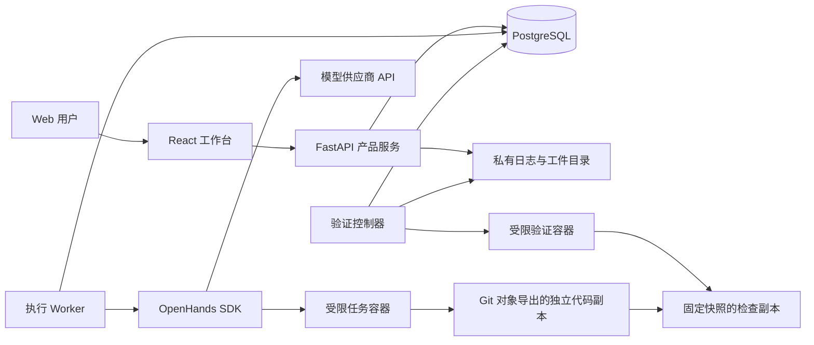

# DooNex 首版架构

更新：2026-11-06 · 状态：M1 受控验收已完成；以下区分现有实现与后续设计，实际验收见 [实施记录](M1_IMPLEMENTATION.md)。

## 1. 选择与边界

M1 已采用 React + TypeScript + Vite、Python 3.12 + FastAPI、OpenHands Software Agent SDK 1.60.1、PostgreSQL 和受限 Docker 工具。应用服务与独立 worker 在 Mac mini 宿主机运行，数据库由 Compose 启动；不向任务传入 Docker socket，不引入 Kubernetes、Redis、向量数据库或自研模型网关。

考虑过的路径：

| 方案 | 优点 | 成本与决定 |
| --- | --- | --- |
| 复用 SDK，自建工作台与评测 | 利用现成运行能力，聚焦产品差异 | 首选；M1 验证所需生命周期与隔离能力 |
| 深度修改整个 OpenHands 应用 | 可沿用较多现成功能 | 需要跟随上游 UI 与业务结构变化；暂不采用 |
| 自研完整 Agent 引擎 | 底层行为完全自行决定 | 重复建设工具、上下文、恢复及模型接入；无验证需求前不采用 |

Python 依赖由 `uv.lock` 锁定，前端由 `apps/web/pnpm-lock.yaml` 锁定。当前任务镜像为 `python:3.12.12-slim-bookworm@sha256:593bd06efe90efa80dc4eee3948be7c0fde4134606dd40d8dd8dbcade98e669c`；PostgreSQL 镜像见 `compose.yaml`，同样使用内容摘要，不使用浮动 `latest`。本机安装和启动以 [README](../README.md) 为准。

本轮已用 `gpt-6.1-sol` 的 Responses 路径完成受控样例的真实修改与固定快照检查；先前 Chat `NotFound` 和 Responses 限流失败均保留。OpenAI 适配器支持 Chat/Responses，Anthropic 适配器仅支持 Chat 且尚未真实调用验证。配置的模型名与静态元数据不代表所有模型能力成立；具体结果与失败记录见实施记录。

## 2. 组件职责



- **Web 工作台**：显示产品状态和证据，发出用户操作；不持有供应商密钥，不直接操纵宿主机。
- **产品服务**：M1 管理项目、任务、权限、预算与运行元数据；Skill 和评测结果属于后续阶段。
- **执行 worker**：领取有持久状态的任务，驱动 SDK；当前为一个有效 worker，进程独立于 Web/API；PostgreSQL 会话级全局 advisory lock 防止双 worker，运行 owner 阻止旧执行者在被接管后继续写状态与结算。
- **SDK**：处理 Agent、会话、工具、模型交互和工作环境接入；用一个薄集成模块连接，不预建通用插件框架。
- **任务环境**：从明确提交的 Git 对象导出独立代码副本，不执行 checkout hooks/filters，不带 `.git` 或原工作区未提交内容。受控 shell 每次启动新容器，仅挂载 `/workspace`，默认无网络；任务内无法使用依赖 `.git` 的命令。
- **验证器**：在 Agent 写入停止后生成覆盖新增/删除、文件内容和文件权限的固定快照，并为每条预先保存的验收命令创建全新检查副本，避免前一检查污染后一检查。验证控制器只负责调度和收集结果；安装脚本、测试命令和被测代码均在受限验证环境执行，不继承控制器的数据库或秘密凭据。后续 Arena 的最终验收器须来自独立受控来源，验收器与保留评测输入不向被评 Agent 开放写权限。

SDK 接口和内部持久化结构可能变化。DooNex 保存自己的产品状态和关联 ID，不重写 SDK 的模型协议、Agent 循环或事件格式。当前薄适配层另包含少量针对 1.60.1 的私有覆盖：禁用宿主技能/插件/记忆发现、默认额外工具、模型元数据探测，并控制预算前置与秘密序列化边界。它们不是稳定的上游扩展合同，升级 SDK 必须重跑隐私、工具、预算、持久化与恢复测试。

SDK 导入前，独立 worker 删除继承的 `LMNR_PROJECT_API_KEY`、`OTEL_ENDPOINT`、`OTEL_EXPORTER_OTLP_TRACES_ENDPOINT`、`OTEL_EXPORTER_OTLP_ENDPOINT`，固定 `LITELLM_MODE=PRODUCTION`、`LITELLM_LOCAL_MODEL_COST_MAP=True`、`OTEL_SDK_DISABLED=true`，防止隐式 `.env` 发现、远程价格表下载与遥测外发。若进程已初始化 tracing 或 LiteLLM 回调则拒绝复用；这不修改用户 shell 的环境。细节以 `apps/server/doonex/sdk.py` 为准。

## 3. 数据与证据

| 概念 | 最少需要保存的内容 |
| --- | --- |
| Project | 项目标识、授权路径、仓库身份、允许的工具与环境配置 |
| Task | 需求、验收规则及版本、所属项目、授权范围 |
| Run | 每次尝试的 ID、任务 ID、起始版本、状态、模型配置、Skill 版本、预算和时间 |
| Agent assignment | 所属运行、角色、职责、父子关系、工作区和交接版本 |
| Event | 顺序号、运行 ID、事件类型、时间、脱敏后的内容或工件引用 |
| Evidence | 最终代码快照标识、diff、检查器版本、命令、退出码、日志与环境 |
| Skill version | 来源、许可证状态、内容哈希、依赖与权限声明、适用任务 |
| Evaluation | 任务集版本、固定配置、各次运行引用、失败分类及汇总口径 |
| Recommendation | 场景、候选版本、证据引用、选择者、生效时间和上一个推荐 |

上表是产品语义，不表示所有表和功能已实现。M1 当前持久化 `project`、`runs`、`events` 与 `actions`；不可变任务输入和验收版本保存在运行的 `request` 中。独立协作角色、Skill、竞技及推荐尚未实现。PostgreSQL 保存可查询状态、动作意图、预算与事件索引；较大日志、补丁、快照及 SDK 会话文件保存在私有工件目录。数据库与工件需一起备份和恢复，工件缺失时显示证据不完整。

起始版本固定为 Git commit；最终代码快照必须覆盖实际验证过的文件状态，包括新增文件，不能只记录一个未包含工作区修改的 HEAD。当前采用 SHA256 内容清单，另保存二进制可用的 Git patch、`snapshot.tar.gz`、逐命令日志、`report.json` 与完整性摘要。报告哈希绑定数据库记录；读取时比对固定快照、当前代码、验收命令和工件哈希，变化或缺失使旧验证失效。扫描拒绝软链接、submodule、特殊文件、常见秘密文件名及资源超限，排除常见生成缓存；不是任意源码内容的完整秘密识别器。

不把私有源码、会话、缓存或真实评测结果提交到 DooNex 的 Git 仓库。产品仓库只保存实现和经审核可分发的样例。

## 4. 执行与恢复

1. 服务校验项目、模型、验收、授权及预算，创建排队中的 Run。
2. Worker 在 PostgreSQL 会话级全局锁下领取运行并保存 owner；失去连接或 owner 的旧 worker 不能推进状态。同一运行不能被两个有效执行者同时推进；当前没有分布式租约调度。
3. 从指定起始提交导出独立代码副本，绑定模型配置、验收版本与环境；M1 不加载 Skill。
4. SDK 运行产生事件，DooNex 持久化进度与用量；发出外部动作前检查范围和剩余预算。
5. Agent 完成修改后停止写入，生成最终快照，运行受信的验证器。
6. 根据证据标记已验证完成、待人工检查或失败；用户可查看并采纳结果。

建议的 Run 状态：

| 状态 | 含义与限制 |
| --- | --- |
| `queued` | 等待资源和预算 |
| `running` | 正在执行，允许派发符合授权的新动作 |
| `pausing` | 已请求暂停，不派发新动作，等待在途动作结束或超时 |
| `paused` | 已停止推进，可按原任务范围恢复 |
| `awaiting_input` / `awaiting_approval` | 需要信息或新增授权，时间流逝不等于获准 |
| `verifying` | 正在验证固定快照，Agent 不能继续修改该快照 |
| `completed_verified` | 对应快照满足预先定义的验收规则 |
| `completed_unverified` | 产物可检查，仍缺少规定的验证或人工确认 |
| `budget_exceeded` | 预算或时长已不允许继续派发，保留结果和原因 |
| `failed` / `cancelled` / `interrupted` | 失败、取消或意外中断；保留实际结果与原因 |

暂停、取消和故障不是同一种状态。取消后若仍有动作在途，界面必须保留其未结束状态；不能宣称进程已经终止。恢复时核对 worker、容器、文件和外部动作记录，不能仅根据聊天内容推测进度。

本地持久化和外部系统之间无法默认获得“恰好一次”执行保证。对推送、发布、部署等动作记录意图与返回证据；若中断发生在结果未知的窗口，先查询目标状态，无法判断则等待人工处理，禁止自动重复。

浏览器只负责连接和展示。当前使用带事件游标的 HTTP 轮询，刷新不重建 Run；日志、diff 和工件由鉴权 API 提供。SSE 或双向通道不是 M1 前置依赖。验证期暂停后保留旧证据，恢复时另开检查尝试；SDK 存在未决动作时要求核查并确认新会话续接，禁止自动重放。

## 5. 协作与预算

M1 是单 Agent；M2 增加执行与审查角色。审查默认只读，修改由执行者完成。只有真正独立的修改任务才分配多个可写工作区；一个整合者检查冲突并验证合并后的代码。

默认最多一层委派、最多两项并发 Agent 工作。所有子运行、重试和评测都计入所属任务或批次总预算，不能通过另开会话绕开上限。

发出模型请求前预留估算额度，返回后按供应商报告的用量结算；记录价格版本、缓存计价和估算状态。无法准确预估的供应商还要依靠调用数、token、时长限制兜底。按量模式未知价格或费用上限时阻止启动；费用上限是调用调度约束，不应宣传成供应商账单的绝对硬封顶。用户明确确认的包月模式将费用、费用预留和费用上限保存为 `null`，仍强制调用数、token 与时长上限，不能显示为免费。时长从首次启动开始，包含暂停时间，续接不清零预算。

## 6. 权限与秘密

- 控制服务、SDK 会话与任务代码分开权限。任务代码不得获得应用数据库、宿主 SSH 或模型管理凭据。
- SDK 需要的模型秘密仅提供给必要的受信运行部分，不因会话创建而进入 Agent 可读的项目文件。
- 持久化密钥采用服务端秘密存储或加密引用；普通日志脱敏，保存前验证 SDK 的实际序列化行为。
- 容器不默认使用特权模式、不挂载宿主 Docker socket、不映射整个用户目录。Docker/worktree 都不能单独证明任务安全，必须验证挂载、网络、进程权限与可用工具。
- 外部 Skill 的提示、脚本和依赖属于不可信输入。权限由用户和控制服务决定，不由 Skill 文本授予。
- 当前 API 绑定 `127.0.0.1:8741`，使用私有 `access-token` 的 Bearer 认证，并校验 Host/Origin。`service.json`、`credentials.json` 与令牌位于私有数据目录，凭据文件权限为 0600；任务容器不挂载该目录。其他设备或公网访问尚未实现，需另行配置认证和受控连接。

## 7. 代码组织建议

当前目录职责：

```text
apps/web/             Web 客户端
apps/server/          产品 API、worker、SDK 集成、预算与证据
tests/               模拟供应商合同、数据库与真实容器回归
scripts/             本机配置、临时数据库测试与显式真实验收
docs/                产品与技术规范
```

Python 使用 `uv` 锁定，Web 使用 `pnpm` 锁定。真实安装、启动与检查命令见 [README](../README.md)，兼容性和逐项验收结果见 [M1 实施记录](M1_IMPLEMENTATION.md)。

## 8. M1 接入与发布验收清单

- Apple Silicon 上镜像可运行，工作区挂载与文件权限正确。
- 实际模型 ID、工具调用和超时处理可用；不假设聊天产品套餐包含 API 额度。
- 会话能保存、恢复和关联应用事件；进程重启后状态可信。
- 暂停/取消对在途动作的实际效果已测量并记录。
- 凭据不会泄漏到模型可见文件、日志、数据库普通字段或导出工件。
- 固定代码快照的验证结果可复查；工具拒绝越界访问。
- 依赖及镜像版本锁定，上游许可证记录与实际版本一致。

受控样例与自动检查已取得的结果见 [实施记录](M1_IMPLEMENTATION.md)。真实界面的工件、日志与下载已复核；这些检查不代表任意供应商、接口、项目或硬件已经兼容。

## 9. 上游来源

于 2026-11-06 查阅的主要来源：

- [OpenHands Software Agent SDK](https://github.com/OpenHands/software-agent-sdk)：Agent、工具、会话、工作区及 Agent Server 能力边界。
- [SDK 会话状态实现](https://github.com/OpenHands/software-agent-sdk/blob/main/openhands-sdk/openhands/sdk/conversation/state.py)：持久化及状态恢复的参考，实际接入仍以锁定版本测试为准。
- [SDK 许可证](https://github.com/OpenHands/software-agent-sdk/blob/main/LICENSE)：当前上游 MIT 许可。

引用上游用于说明依赖和参考来源；当前已集成的能力与限制以本文件及实施记录为准，不表示实现了上游全部功能。
