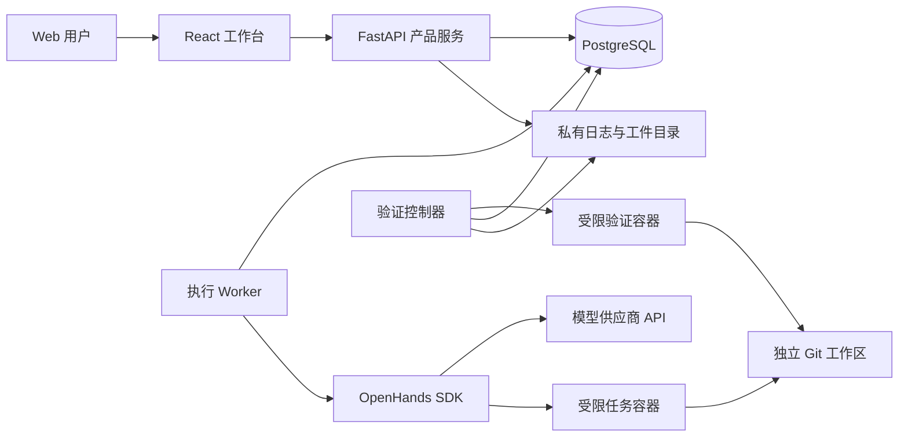

# DooNex 首版架构

更新：2026-11-06 · 状态：设计基线，尚无对应应用代码。

## 1. 选择与边界

首版拟采用 React + TypeScript + Vite、Python + FastAPI、OpenHands Software Agent SDK、PostgreSQL 和容器工作区。先在单台 Mac mini 上运行应用服务、执行 worker 和数据库，不预先引入 Kubernetes、Redis、向量数据库或自研模型网关。

考虑过的路径：

| 方案 | 优点 | 成本与决定 |
| --- | --- | --- |
| 复用 SDK，自建工作台与评测 | 利用现成运行能力，聚焦产品差异 | 首选；M1 验证所需生命周期与隔离能力 |
| 深度修改整个 OpenHands 应用 | 可沿用较多现成功能 | 需要跟随上游 UI 与业务结构变化；暂不采用 |
| 自研完整 Agent 引擎 | 底层行为完全自行决定 | 重复建设工具、上下文、恢复及模型接入；无验证需求前不采用 |

这些是设计选择，不是安装清单。M1 要锁定实际依赖版本和容器镜像，记录兼容性验证；不能依靠浮动 `latest` 复现实验。

## 2. 组件职责



- **Web 工作台**：显示产品状态和证据，发出用户操作；不持有供应商密钥，不直接操纵宿主机。
- **产品服务**：管理项目、任务、权限、预算、运行元数据、Skill 和评测结果。
- **执行 worker**：领取有持久状态的任务，驱动 SDK；初期一个 worker 即可，进程职责独立于 Web 请求。
- **SDK**：处理 Agent、会话、工具、模型交互和工作环境接入；用一个薄集成模块连接，不预建通用插件框架。
- **任务环境**：使用独立 checkout/worktree 和受限容器；对任务只开放必要的项目路径、工具及网络访问。
- **验证器**：在 Agent 写入停止后运行受信的检查规则，记录结果。验证控制器只负责调度和收集结果；安装脚本、测试命令和被测代码均在受限验证环境执行，不继承控制器的数据库或秘密凭据。Arena 的最终验收器来自独立受控来源，验收器与保留评测输入不向被评 Agent 开放写权限。

SDK 接口和内部持久化结构可能变化。DooNex 保存自己的产品状态和关联 ID；通过公开 SDK API 使用会话，不直接改写上游内部事件格式。

## 3. 数据与证据

| 概念 | 最少需要保存的内容 |
| --- | --- |
| Project | 项目标识、授权路径、仓库身份、允许的工具与环境配置 |
| Task | 需求、验收规则及版本、所属项目、授权范围 |
| Run | 每次尝试的 ID、任务 ID、起始版本、状态、模型配置、Skill 版本、预算和时间 |
| Agent assignment | 所属运行、角色、职责、父子关系、工作区和交接版本 |
| Event | 顺序号、运行 ID、事件类型、时间、脱敏后的内容或工件引用 |
| Evidence | 最终代码快照标识、diff、检查器版本、命令、退出码、日志与环境 |
| Skill version | 来源、许可证状态、内容哈希、依赖与权限声明、适用任务 |
| Evaluation | 任务集版本、固定配置、各次运行引用、失败分类及汇总口径 |
| Recommendation | 场景、候选版本、证据引用、选择者、生效时间和上一个推荐 |

PostgreSQL 保存可查询元数据及事件索引；较大日志、补丁、快照及 SDK 会话文件保存在私有工件目录。数据库与工件需一起备份和恢复，工件缺失时显示证据不完整。

起始版本固定为 Git commit；最终代码快照必须覆盖实际验证过的文件状态，包括新增文件，不能只记录一个未包含工作区修改的 HEAD。实现时选择临时提交或可校验的内容清单，秘密和生成物不得进入证据快照。

不把私有源码、会话、缓存或真实评测结果提交到 DooNex 的 Git 仓库。产品仓库只保存实现和经审核可分发的样例。

## 4. 执行与恢复

1. 服务校验项目、模型、验收、授权及预算，创建排队中的 Run。
2. Worker 领取运行并获得带期限的执行权；同一运行不能被两个 worker 同时推进。
3. 从指定起始提交创建独立工作区，绑定模型、Skill 内容哈希和环境版本。
4. SDK 运行产生事件，DooNex 持久化进度与用量；发出外部动作前检查范围和剩余预算。
5. Agent 完成修改后停止写入，生成最终快照，运行受信的验证器。
6. 根据证据标记已验证完成、待人工检查或失败；用户可查看并采纳结果。

建议的 Run 状态：

| 状态 | 含义与限制 |
| --- | --- |
| `queued` | 等待资源和预算 |
| `running` | 正在执行，允许派发符合授权的新动作 |
| `pausing` | 已请求暂停，不派发新动作，等待在途动作结束或超时 |
| `paused` | 已停止推进，可按原任务范围恢复 |
| `awaiting_input` / `awaiting_approval` | 需要信息或新增授权，时间流逝不等于获准 |
| `verifying` | 正在验证固定快照，Agent 不能继续修改该快照 |
| `completed_verified` | 对应快照满足预先定义的验收规则 |
| `completed_unverified` | 产物可检查，仍缺少规定的验证或人工确认 |
| `failed` / `cancelled` / `interrupted` | 失败、取消或意外中断；保留实际结果与原因 |

暂停、取消和故障不是同一种状态。取消后若仍有动作在途，界面必须保留其未结束状态；不能宣称进程已经终止。恢复时核对 worker、容器、文件和外部动作记录，不能仅根据聊天内容推测进度。

本地持久化和外部系统之间无法默认获得“恰好一次”执行保证。对推送、发布、部署等动作记录意图与返回证据；若中断发生在结果未知的窗口，先查询目标状态，无法判断则等待人工处理，禁止自动重复。

浏览器只负责连接和展示。页面刷新不重建 Run，断线重连按事件游标补齐；优先使用满足需求的 HTTP + SSE，只有双向实时需求成立后再引入额外通道。

## 5. 协作与预算

M1 是单 Agent；M2 增加执行与审查角色。审查默认只读，修改由执行者完成。只有真正独立的修改任务才分配多个可写工作区；一个整合者检查冲突并验证合并后的代码。

默认最多一层委派、最多两项并发 Agent 工作。所有子运行、重试和评测都计入所属任务或批次总预算，不能通过另开会话绕开上限。

发出模型请求前预留估算额度，返回后按供应商报告的用量结算；记录价格版本、缓存计价和估算状态。无法准确预估的供应商还要依靠调用数、token、时长限制兜底。费用上限是调用调度约束，不应宣传成供应商账单的绝对硬封顶。

## 6. 权限与秘密

- 控制服务、SDK 会话与任务代码分开权限。任务代码不得获得应用数据库、宿主 SSH 或模型管理凭据。
- SDK 需要的模型秘密仅提供给必要的受信运行部分，不因会话创建而进入 Agent 可读的项目文件。
- 持久化密钥采用服务端秘密存储或加密引用；普通日志脱敏，保存前验证 SDK 的实际序列化行为。
- 容器不默认使用特权模式、不挂载宿主 Docker socket、不映射整个用户目录。Docker/worktree 都不能单独证明任务安全，必须验证挂载、网络、进程权限与可用工具。
- 外部 Skill 的提示、脚本和依赖属于不可信输入。权限由用户和控制服务决定，不由 Skill 文本授予。
- 默认仅本机可达；需要其他设备访问时先采用受控私有连接，并配置应用身份验证、来源校验和敏感操作审计。

## 7. 代码组织建议

应用代码出现后再按需求建立目录，当前不创建空壳：

```text
apps/web/             Web 客户端
apps/server/          产品 API、worker、SDK 集成与评测逻辑
tests/               跨模块验收与受控样例
docs/                产品与技术规范
```

Python 依赖拟使用 `uv` 锁定，Web 依赖拟使用 `pnpm` 锁定。M1 时验证工具版本并补充真实命令；不要现在提供不可执行的安装教程。

## 8. M1 接入验证清单

- Apple Silicon 上镜像可运行，工作区挂载与文件权限正确。
- 实际模型 ID、工具调用和超时处理可用；不假设聊天产品套餐包含 API 额度。
- 会话能保存、恢复和关联应用事件；进程重启后状态可信。
- 暂停/取消对在途动作的实际效果已测量并记录。
- 凭据不会泄漏到模型可见文件、日志、数据库普通字段或导出工件。
- 固定代码快照的验证结果可复查；工具拒绝越界访问。
- 依赖及镜像版本锁定，上游许可证记录与实际版本一致。

## 9. 上游来源

于 2026-11-06 查阅的主要来源：

- [OpenHands Software Agent SDK](https://github.com/OpenHands/software-agent-sdk)：Agent、工具、会话、工作区及 Agent Server 能力边界。
- [SDK 会话状态实现](https://github.com/OpenHands/software-agent-sdk/blob/main/openhands-sdk/openhands/sdk/conversation/state.py)：持久化及状态恢复的参考，实际接入仍以锁定版本测试为准。
- [SDK 许可证](https://github.com/OpenHands/software-agent-sdk/blob/main/LICENSE)：当前上游 MIT 许可。

引用上游表示计划依赖或参考，不表示当前仓库已经包含该实现。
